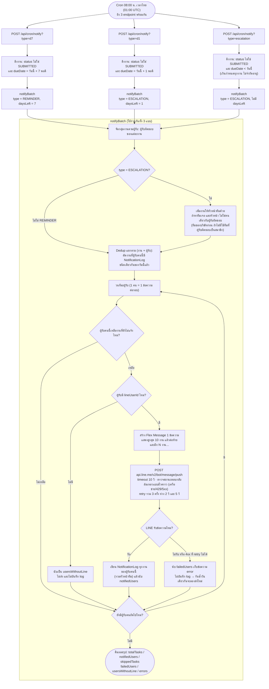

# Flow การแจ้งเตือน LINE (cron) — ตามโค้ดจริง

อัปเดตหลังแก้ retry / การบันทึก log (2026-10-14) — อ่านจากโค้ด ยังไม่ได้ทดสอบรันจริงกับ LINE

## ใครได้รับอะไร

| เงื่อนไข | endpoint | type | ผู้รับ |
|---|---|---|---|
| เหลือ 7 วัน | `d7` | REMINDER | ผู้รับผิดชอบเท่านั้น |
| เหลือ 1 วัน | `d1` | ESCALATION | ผู้รับผิดชอบ + หัวหน้าทีม |
| เกินกำหนด | `escalation` | ESCALATION | ผู้รับผิดชอบ + หัวหน้าทีม (ส่งซ้ำทุกวันจนกว่าจะยื่น) |
| ครบกำหนดวันนี้ (0 วัน), เหลือ 2-6 วัน | - | - | ไม่แจ้ง |

หมายเหตุ: endpoint รองรับ `type=d5` ด้วย แต่ไม่ได้ตั้งเวลาใน `scripts/cron-entrypoint.sh` จึงไม่ทำงาน

## พฤติกรรมที่ควรรู้

1. **log หมายถึง "LINE รับข้อความแล้ว"** เขียนหลังส่งสำเร็จเท่านั้น หัวหน้าทีมก็มี log ของตัวเอง
2. **ส่งไม่สำเร็จ = ไม่มี log** รัน endpoint เดิมซ้ำในวันเดียวกันได้ ระบบจะส่งเฉพาะคนที่ยังไม่ได้รับ ไม่ส่งซ้ำคนที่ได้ไปแล้ว
3. **retry เกิดในคำขอเดียว** (3 ครั้ง ห่าง 2 และ 5 วินาที) ไม่ใช่ 5 นาทีเหมือนในสเปกเดิม เพราะ cron รอผลตอบกลับอยู่ ถ้า LINE ล่มนานกว่านั้น ต้องรันซ้ำเองหรือรอวันถัดไป
4. **ผู้รับที่ไม่มี LINE จะไม่ถูกบันทึก** หน้าประวัติการแจ้งเตือนจึงแสดงเฉพาะที่ส่งถึงจริง ดูได้จาก `usersWithoutLine` ในผลลัพธ์ของ cron
5. **ข้อความเกินกำหนดส่งซ้ำทุกวัน** แสดง 10 งานแรกเท่านั้น ถ้ามีงานค้างมากอาจทำให้คนเมินข้อความ (ยังไม่ได้เปลี่ยน เพราะเป็นเรื่องของนโยบายการแจ้งเตือน)
6. **Supervisor ไม่ได้รับโดยอัตโนมัติ** ผู้ที่ได้รับคือ "หัวหน้าทีม" ตามข้อมูลทีมเท่านั้น
7. **ปุ่ม "ส่งการแจ้งเตือน" ในหน้างาน** (`/api/notifications/send`) ใช้หลักเดียวกัน: บันทึก log เมื่อส่งสำเร็จ และตอบ error ชัดเจนถ้าไม่มีใครได้รับ

## ลิงก์ในการ์ด LINE (เพิ่ม 2026-10-17)

ใช้ผ่าน VPN เท่านั้น (ระบบอยู่ที่ `NEXTAUTH_URL` = IP ภายใน) จึงมีข้อความ "🔒 ต้องเชื่อมต่อ VPN ก่อนกดเปิด MALI" เหนือปุ่ม ถ้าไม่ต่อ VPN แล้วกด เบราว์เซอร์จะเปิดหน้าไม่ติด ซึ่งระบบแสดงข้อความแทนไม่ได้

| กดตรงไหน | ไปที่ |
|---|---|
| แถวงาน (เฉพาะงานที่ผู้รับเปิดดูได้) | `/tasks?taskId=<id>` เปิดรายละเอียดงานนั้น |
| ปุ่ม "เปิด MALI" — เกินกำหนด | `/tasks?status=OVERDUE` |
| ปุ่ม "เปิด MALI" — เหลือ 7 / 1 วัน | `/tasks?due=YYYY-MM-DD` |
| ปุ่มในสรุปรายคน / สรุปทีม | `/tasks` / `/dashboard` |

- ผู้รับที่เป็นเจ้าหน้าที่เปิดได้เฉพาะงานของตัวเอง จึงเห็นแถวของงานคนอื่น (เช่นหัวหน้าทีมที่เป็นเจ้าหน้าที่) เป็นข้อความธรรมดาไม่มีลูกศร
- ลิงก์แสดงสถานะ ณ ตอนกด งานที่ยื่นไปแล้วระหว่างนั้นจะไม่อยู่ในรายการ
- ถ้ายังไม่ได้ล็อกอิน ระบบพาไปล็อกอินแล้วกลับมาหน้าที่กดมา (`/login?callbackUrl=…` รับเฉพาะ path ภายใน)
- ถ้าไม่ตั้ง `NEXTAUTH_URL` การ์ดจะไม่มีปุ่ม/ลิงก์

## อ้างอิงโค้ด

- `app/api/cron/notify/route.ts` — query งานแต่ละแบบ และข้อความสรุป
- `lib/cronNotify.ts` — `notifyBatch`
- `lib/lineFlex.ts` — `buildFlexMessage` (การ์ด, ปุ่ม, แถวที่กดได้)
- `lib/appLinks.ts` — ตัวสร้างลิงก์
- `lib/lineClient.ts` — `sendLineMessage` (ตรวจสถานะ, retry, timeout)
- `scripts/cron-entrypoint.sh` — ตารางเวลา cron
- เทสต์: `lib/lineClient.test.ts`, `lib/cronNotify.test.ts`
